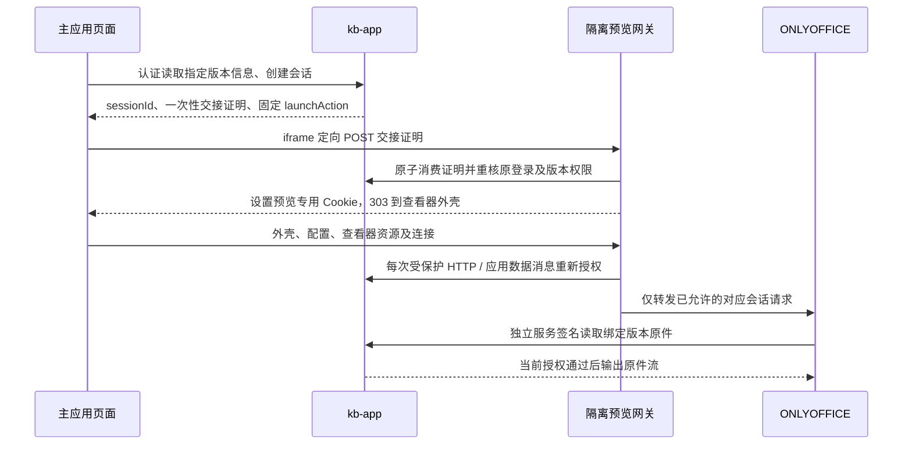

# Design

## Context

动机见 [proposal.md](proposal.md)。行为契约分别见 [office-preview](specs/office-preview/spec.md) 和 [user-web-documents](specs/user-web-documents/spec.md)。以下为拟实现方案，协议和真实文件效果尚未联调。

当前 `DocumentController` 的预览接口在 `DocumentManagementService.file(..., PERM_VIEW)` 后仅输出 PDF 或文本；下载另用 `PERM_DOWNLOAD`。`DocumentMapper.findFile` 同时限制空间、密级、删除状态及未发布版本参与资格。`PermissionService` 明确要求下一次请求读取当前权限，不能跨请求缓存允许结果。

`kb-web/src/FileAccess.tsx` 使用认证请求读取 Blob，文档详情、审核面板和引用抽屉已有版本与身份生命周期处理。`SessionProvider` 的普通业务请求使用认证头和 `credentials: 'omit'`，页面隐藏及身份重核会清理私有状态。直接把 ONLYOFFICE 脚本加载到主页面，会让第三方代码进入存放登录凭据的 Origin；只向文档服务发出短期配置签名，也无法约束其缓存读取。

现有 Redis 可承载短期会话；`RedisSsoFlowStore` 提供原子消费和容量回收的参考。网关是 Spring Cloud Gateway，业务权限仍属于 `kb-app`。现有文件策略已经区分 OOXML 与旧 Office 格式，预览不需要改动解析 Worker、向量模型或数据库结构。

## Goals / Non-Goals

**Goals:**

- 将浏览器身份交接、供应商配置签名、服务取件认证和当前文档授权拆成明确的信任边界。
- 让每次新内容读取受当前原登录与固定版本权限约束，包含供应商缓存和已建立连接。
- 以统一预览组件接入现有页面，在服务未启用或灰度部署时保留原文件入口。

**Non-Goals:**

- 不将“禁止下载按钮”描述为防止用户保存已看见内容的 DRM，也不承诺追回已交付字节。
- 不实现编辑、保存、协同、格式转换、服务端页码映射或额外的预览产物生命周期。
- 不重构现有身份系统，不用管理权限、解析任务状态或供应商用户身份代替知识库授权。

## Decisions

### 1. 选用 ONLYOFFICE 的普通只读查看器，固定协议适配版本

采用独立部署的 ONLYOFFICE Docs，使用 `editorConfig.mode: "view"` 和 `coEditing: { mode: "strict", change: false }` 的普通查看模式。由后端签发完整配置，关闭编辑、批注写入、修订、填表、聊天、插件、外部集成以及查看器内的下载、打印。应用内原件下载继续调用原有下载接口。

只接受 `.docx`、`.xlsx`、`.pptx`。供应商内部解析与临时缓存是渲染过程的一部分，不调用转换 API、不生成 PDF、不写回原件。选择服务端原生查看器是为了保留表格与幻灯片交互；纯前端分格式渲染的兼容成本较高，PDF 转换不符合已确认需求，公开 Office 查看服务也不满足受保护文件访问边界。

根据所选发行版的官方文档与源码固定镜像 digest、虚拟路径、配置签名、服务取件签名、缓存 URL 与文档 key 绑定、HTTP/长连接路由及只读操作清单，作为适配代码和静态测试数据的依据。镜像版本变更时同步审查适配代码和隔离单测。

本变更仅安排无需启动前端、应用服务或外部组件的隔离单元/组件测试和静态构建，不安排真实 ONLYOFFICE 协议实验、数据库/Redis 联调、浏览器端到端测试或部署回退演练。存储、权限、HTTP 和 WebSocket 使用进程内 mock/fake；前端通过 Vitest/jsdom 模拟网络和查看器消息。只运行明确筛选的隔离测试，不引入嵌入式中间件或 Testcontainers，也不编写说明文档内容断言测试。

选定的实现仍是受控代理，未知路径、消息和不能确认授权的请求必须拒绝，不采用直连、转换或降低授权作为替代。隔离测试只能说明应用逻辑的行为，不能证明真实文档服务兼容性、Redis 脚本并发效果或 Office 排版已通过联调；这些边界如实保留，不构成本任务清单的外部环境验收前置条件。官方虚拟路径示例也不是本方案的运行结果。

### 2. 用隔离 Origin 承载查看器，通过一次性 POST 建立专用证明

生产使用同站点、不同 Origin 的 HTTPS 域名，例如主应用 `https://kb.example.invalid` 和预览 `https://preview.example.invalid`。预览域名只指向受控网关；ONLYOFFICE 不发布浏览器可直连端口。独立 Origin 隔离主应用的 `sessionStorage`，同站点部署使浏览器不依赖第三方 Cookie。

主页面只从现有认证 API 取得交接响应，用表单 POST 到预览域名的 `/s/{sessionId}/bootstrap`，目标是当前 iframe。交接证明至少 256 位随机数，仅存摘要、短时、一次消费，绑定会话与允许的主应用 Origin。拒绝缺失、`null` 或不匹配的 Origin，不在 URL、跳转参数、日志和 Referer 中传证明。

激活成功后设置专用 `__Secure-kb-office-preview` Cookie：`Secure`、`HttpOnly`、`SameSite=Strict`、无 `Domain`，`Path=/s/{sessionId}/`，有效期不超过会话期限。每个会话不同路径及随机证明，不把主应用令牌复制到 Cookie。SID 只是不可枚举的标识，本身不能授权。限定 Cookie 路径用于实例隔离，不将其声称为同 Origin 脚本之间的安全边界。

外壳在隔离 Origin 加载 `api.js`，签名配置也仅在该 Origin 返回。主应用校验 `launchAction` 的精确 Origin、路径与 SID；拒绝供应商或响应中提供的任意启动地址。外壳使用限制性的 CSP、`frame-ancestors`、`no-referrer`、`no-store`；iframe 不允许任意顶层导航、弹窗或下载。必要脚本及内部 iframe 的沙箱能力按所选版本协议配置最小集合。普通 `Session.send` 继续 `credentials: 'omit'`，无需扩大现有 CORS 或把 Office 路径加入通用免登录列表。

不采用主页面直接加载供应商脚本、URL 携带 `satoken`、共享域登录 Cookie 或无认证的长期 iframe 地址。

### 3. 新增固定版本协议，与现有二进制预览分开

以下是新接口的约定，所有 ID 按项目现有精确 ID 方式序列化，前端不得经过不安全的 `Number` 转换。成功业务响应沿用 `R` 包装，文件流与外壳响应除外。

| 入口 | 行为 |
| --- | --- |
| `GET /api/documents/{docId}/versions/{versionId}/preview-info` | 先核对当前资格，再返回 `protocolVersion: 1`、精确目标、`DIRECT / OFFICE / UNSUPPORTED / UNAVAILABLE` 和有限原因码。`DIRECT` 仅给出既有同源受保护路径，Office 未启用返回 `UNAVAILABLE`。 |
| `POST /api/documents/{docId}/versions/{versionId}/office-preview/sessions` | 重核资格、格式、配置及容量；返回 `sessionId`、`launchAction`、一次性 `launchToken`、`expiresAt`、`protocolVersion: 1`。不接收源 URL、供应商配置或客户端权限值。 |
| `POST /api/office-preview/sessions/{sessionId}/heartbeat` | 核对当前请求与原登录为同一会话，并重核版本资格；只能续活动租约，不能改变目标或延长绝对期限。 |
| `DELETE /api/office-preview/sessions/{sessionId}` | 当前认证请求有界关闭自有会话，重复或已过期返回统一成功，跨用户标识不产生任何效果或目标披露；返回 `R`。 |
| 预览 Origin：`POST /s/{sessionId}/bootstrap` | 验证来源、正文证明与当前资格；原子消费并建立专用 Cookie，303 到无凭据参数的查看器地址。 |
| 预览 Origin：`/s/{sessionId}/view` 及允许的子路由 | 外壳、配置及供应商资源代理；受专用证明和当前授权约束。 |
| 内部：`/internal/office-preview/authorize` | 只接受网关服务认证；根据会话、证明和规范化资源身份返回最小授权结果，供 HTTP 与消息转发前使用。 |
| 内部：`GET /internal/office-preview/sessions/{sessionId}/source` | 只接受文档服务取件认证；按精确会话和当前授权流式返回原件。 |

`preview-info` 的格式/状态不是权限探测旁路：依赖异常返回 503，不可见先返回 404，不把不可见文件的类型或服务状态返回给调用方。会话建立不能仅信任前一次 descriptor。HTTP 错误映射遵循规格；上游错误归一化为固定类别和安全关联标识。

保留现有 `/preview` 二进制契约，避免 `FilePreview` 或已有消费者将配置 JSON 当作文件。新前端遇到旧后端的 404/405，Office 显示服务不支持或目标不可访问；PDF/文本仍可调用原受保护文件入口，以其实际结果决定显示，不能从 descriptor 的 404 推断文档已删除。未知新协议不触发猜测或自动降级到直链。

### 4. Redis 保存有限预览会话，当前授权由应用统一执行

新增 `document.preview` 包，以 `DocumentManagementService.file(actorId, docId, versionId, PERM_VIEW)` 为固定版本访问入口；抽取必要复用点时仍由现有 `PermissionService` 和版本 SQL 决定当前资格。独立内部请求不能伪造普通浏览器上下文或只凭 `actorId` 放行，还须核验原登录有效、未强制改密，以及主体启用、部门、密级、空间和候选版本资格。

Redis 会话至少保存：随机 SID、用户 ID、原登录的服务端引用、精确 docId/versionId、受控服务标识、会话唯一 `document.key`、创建与绝对过期时间、活动租约、状态、交接与 Cookie 证明摘要。原登录引用必须可通过现有 Sa-Token 权威存储验证原始登录，不能只查“该用户目前是否在线”；若适配必须保存原令牌，仅在内部短期记录中保存，不进入 DTO、配置、签名载荷、日志或文档服务。普通请求和独立内部请求均不得建立跨请求的正向授权缓存。

状态只有 `PENDING → ACTIVE → CLOSED/EXPIRED`。原子创建同时检查用户与全局额度；交接证明一次消费；激活、保活、关闭均使用状态与期限条件更新，迟到更新不能复活已关闭会话。参考 SSO 存储的 Redis 脚本模式，使用独立键空间和有界过期索引，清理时同步回收额度。Redis 不可用时拒绝建立和读取，不退回进程内允许记录。

初始默认值：交接有效期 60 秒、活动租约 45 秒、前端保活间隔 15 秒、会话绝对期限 30 分钟、每用户最多 3 个活动或待激活会话、全局最多 100 个。均配置化并校验有限范围；实际启用上限还应不超过部署容量与所选服务版本能力。供应商资源读取不代替主页面保活。超出绝对期限后由用户重新打开，不自动新建或无界续期。

`document.key` 使用部署实例、固定版本和随机预览会话派生的不可逆短字符串，满足供应商长度/字符约束，且不同用户打开同版本也不共用。选择放弃跨用户缓存复用，避免共享缓存身份增加授权复杂度。Redis 只记录访问上下文，不存正文、不建预览业务表。

### 5. 原件桥接只信任独立服务凭据

ONLYOFFICE 配置中的 `document.url` 指向专用内部原件桥接；不含 S3 地址、对象键、预签名地址或用户令牌。桥接在独立服务认证、会话 ACTIVE、原登录与当前版本资格全部通过后，调用现有原件读取能力并流式返回。资格检查完成后不持有数据库事务等待对象存储或网络响应。

使用 ONLYOFFICE 的 outbox 请求签名配置认证取件请求，与浏览器配置签名使用不同秘密和用途；另为网关到应用的授权请求设置独立服务认证。按所选版本协议固定签名算法、头名、签名载荷中的请求目标绑定方式及可接受期限，校验请求实际方法、路径、目标会话，拒绝算法降级、错用途和改目标重放。网关不能替浏览器补签一份取件凭据。

内部路径仅在服务网络可达，也必须执行应用级认证；公网网关没有对应通配转发。复制配置或知道桥接 URL 不足以取件。只读模式不提供保存能力；如选定版本必须接收生命周期回调，仅为有限状态设置独立认证处理器，保存/导出状态拒绝，不下载回调 URL、不更新任何业务文件或状态。

不能仅用网络位置、浏览器配置 JWT、固定长期裸 URL 或短期对象存储直链代替这条认证链。

### 6. 网关同时约束缓存资源和双向长连接消息

预览流量使用独立路由组和处理器，业务授权调用 `kb-app`，网关不复制权限 SQL。只接受配置好的预览 Host、目标 ONLYOFFICE 服务和协议允许清单；忽略客户端伪造的转发头，按部署配置重建上游 Host/Forwarded 信息。进入上游前移除 `satoken`、预览 Cookie、内部认证头和可能携带用户信息的遥测 baggage，只传供应商协议所需字段。

供应商虚拟路径置于 `/s/{sessionId}/...` 下。路径规范化后验证 SID、实际请求方法、允许的资源类型及其中的 `document.key`。拒绝穿越、重复编码绕过、跨会话 key、任意目标 URL、未知路由和绝对重定向逃逸；所有响应中的文档资源地址必须仍落在受控入口，不能从 `Location` 或正文导向裸文档服务。仅明确验证不含文档内容的静态资产可以列入公共静态白名单，缓存文件、图片、媒体和原件不属于该集合。

每个受保护 HTTP 请求先完成当前授权。长连接在建立前核验 Origin、专用证明和当前资格；建立后使用可解析的双向应用消息中继，在每条应用数据消息转发前重新调用当前授权，同时按所选版本的协议清单核对目标 key 和只读操作。禁止保存、转换、下载、导出等消息或备用 HTTP 路由。WebSocket ping/pong 等控制帧不承载正文；空闲连接也定时核验租约与授权，不能依靠一直空闲保活。不能使用只在握手时鉴权的透明隧道。

授权失败、超时或依赖不可确认时停止两侧转发并关闭连接。网关每次只保留有限的在途消息，设置帧/消息长度、缓冲、队列、并发、连接和调用超时上限；应用授权使用非阻塞 HTTP 调用，不能在网关事件循环执行阻塞数据库查询。消息分片必须有界聚合并防止重组绕过。HTTP 原件与大资源使用有界流式传输，不把整份文件无限聚合到内存。具体字节上限根据现有上传上限和所选版本的协议定义确定，并成为配置校验与隔离单测的边界数据。

一次已经准入的 HTTP 响应允许按既有文件流语义完成；撤权后新 HTTP 与新应用数据消息不得放行。前端清屏、租约过期和供应商 `drop` 只能辅助清理，不能替代服务端读取授权。尤其 `drop` 仅终止编辑连接，官方说明用户仍可以查看，故不用于实现阅读撤权。

### 7. 共用组件提供大尺寸阅读，并服从现有身份生命周期

在 `FileAccess.tsx` 外增加按精确文档及版本 ID 工作的预览适配层。`DIRECT` 分支复用当前 `FilePreview`；`OFFICE` 分支提供可占满可用屏幕的大尺寸模态查看器，Excel 横向滚动与工作表切换、PPT 翻页在原生查看器内完成。使用模态层保留现有 `SessionProvider` 与调用页面的生命周期，不新增独立登录或放宽返回路径路由规则。

文档详情使用明确的版本选择，审核面板使用当前可读候选，引用抽屉使用已验证响应中的 docId/versionId。维持引用 DTO、JSON/SSE、`previewPath`、`downloadPath` 的现有契约，不把老引用改写到最新版本。缺少精确版本或解析器页码无法映射时不猜测目标；片段来源提示仍显示为提示。

组件状态至少区分：未打开、信息核对中、打开中、可阅读、不支持、未启用、不可用、会话失效、容量拒绝。只有隔离外壳收到当前 ONLYOFFICE 实例的就绪事件后才向父页报告 ready。父页只接收有限的 ready/error/closed 消息，验证精确 Origin、`event.source`、SID 和打开代次；不接收任意导航、文件 URL 或要求发送凭据的命令。

版本切换、隐藏、退出、强制改密及身份重核都立即卸载 iframe、停止保活、清理交接数据并取消在途业务请求。关闭 API 尽力有界调用，不能在错误后保留显示，也不能把未知关闭结果说成已完成服务端清理。恢复时先核对身份与资源，再由用户重新打开。晚到的 descriptor、会话响应、iframe 事件或保活响应必须受身份与打开代次保护；创建响应丢失不自动重新 POST。浏览器意外终止依靠有限租约回收。

### 8. 默认关闭、限制网络，并提供专用部署与验证资料

Office 配置独立成组，至少包括 enabled、允许的主应用/预览 Origin、受控上游及内部桥接地址、不同用途的签名秘密、会话/容量/字节/超时上限和固定协议适配版本。关闭时不要求未使用的供应商配置；启用时校验完整性，缺失或不匹配应明确失败，不能以不安全默认值启动。检查开关属于每次授权的一部分；多副本环境关闭时先在所有预览入口阻断新流量及长连接，再完成应用配置回退，避免部分实例继续服务。

增加可选 Office 编排与反向代理示例，不改变现有默认中间件启动行为。文档服务无公网入口；出站网络仅允许受控原件桥接、必要内部依赖和已审定基础设施，拒绝文档触发的任意内外网取数。浏览器预览 Origin 使用相应 CSP；文档超链接不能自动触发取数或顶层导航。沿用原件文件策略，宏、嵌入式活动内容不放开；加密或损坏文件安全失败，不收集密码或转交其他服务。

新增 `docs/office-preview.md` 说明接口、固定镜像与协议范围、密钥用途、域名/TLS、部署开关、有限缓存清理、运维和回退；同步 `docs/user-web-operations.md`。文档作为交付项编写，不新增联调记录或检查文档包含指定内容的测试。隔离测试数据使用非敏感内容，测试输出不保存正文、认证头、Cookie、交接票据或可重放签名。指标只使用固定错误类别、路由模板和聚合计数，不把 SID、用户/文档 ID 或 URL 作为指标标签。

### 外部协议依据

以下官方资料用于设计选择，不表示固定镜像已在本项目完成联调：

- [打开文件机制](https://api.onlyoffice.com/docs/docs-api/get-started/how-it-works/opening-file)：现代 Office 文件可原生打开，其他格式可能在服务内转换。
- [查看模式](https://api.onlyoffice.com/docs/docs-api/get-started/how-it-works/viewing)：普通只读与实时查看的配置区别。
- [文档配置及缓存 key](https://api.onlyoffice.com/docs/docs-api/usage-api/config/document)、[权限配置](https://api.onlyoffice.com/docs/docs-api/usage-api/config/document/permissions)：配置字段及其作用，不能当作平台当前授权。
- [签名机制](https://api.onlyoffice.com/docs/docs-api/additional-api/signature)、[请求签名](https://api.onlyoffice.com/docs/docs-api/additional-api/signature/request)：区分浏览器配置与服务请求的凭据用途。
- [官方虚拟路径代理示例](https://github.com/ONLYOFFICE/document-server-proxy/blob/master/nginx/proxy-to-virtual-path.conf)：用于受控路径适配的协议参考。
- [drop 命令](https://api.onlyoffice.com/docs/docs-api/additional-api/command-service/drop)：不能作为撤销阅读能力的依据。

## Risks / Trade-offs

- [供应商缓存或协议路由逃出受控路径] → 固定镜像、默认拒绝未知资源、以模拟请求及消息测试应用授权；真实服务兼容性不在本次隔离测试证明范围内。
- [逐消息授权增加数据库和网络负担] → 使用普通只读模式并限制并发与缓冲；请求内允许复用现有身份句柄，不引入跨请求允许缓存。本任务不包含真实负载测试。
- [Office 排版受字体、公式与嵌入对象影响] → 保留必要字体与查看器配置说明；实际排版效果未经本次任务验证，不承诺与桌面 Office 完全一致。
- [外部内容或第三方脚本扩大访问范围] → 独立 Origin、CSP、服务出站允许清单、禁用插件/活动内容及最小 iframe 权限，应用侧规则以隔离单测覆盖；不将其表述为部署网络已验证。
- [30 分钟绝对期限或页面隐藏打断阅读] → 明确显示会话失效并允许主动重新打开；本期沿用现有私有状态清理规则，不静默延长旧授权。
- [关闭请求丢失或服务留有缓存] → 有限租约、绝对 TTL、当前读取授权与服务缓存保留策略分别约束；Redis 会话删除不等于供应商缓存已物理删除。
- [只读与禁下载被误解为无法复制] → 明确原件下载授权和已显示内容的区别，不承诺阻止截图或保存已接收字节。
- [需要额外域名、TLS、服务资源和版本维护] → 可选部署、默认关闭；实施选型记录所用发行版的部署适用性和容量，升级同步审查协议适配及隔离单测。

## Migration Plan

以下描述运行时部署与回退顺序，当前任务只交付代码、配置及操作说明，不执行部署、服务启动或回退演练，也不以这些操作完成作为任务勾选条件。

1. 使用固定镜像与协议允许清单，准备同站点预览域名、TLS、服务网络及不同用途的密钥。
2. 后端、网关及前端适配层默认关闭 Office 功能，未启用环境显示明确提示；按环境提供代理、缓存保留和资源上限配置，由运维显式管理启用状态。
3. 回退时先关闭所有预览入口并终止活动中继，再回退前端、网关与应用。保留原件和业务版本，不执行数据库迁移、重新解析或重新发布。
4. Redis 会话与供应商缓存遵循各自有限期限回收；清理记录只包含聚合状态，不输出私有文档或凭据。
